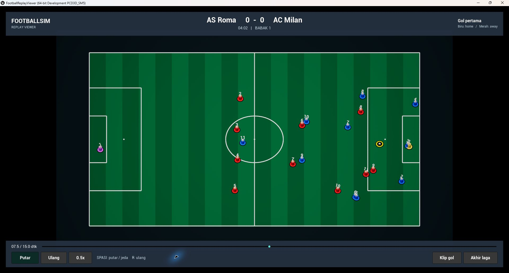

# taktik-manajer-sepak-bola

Prototipe manajemen sepak bola dengan match engine C++ dan viewer replay Unreal Engine 5.8.

## Progres saat ini

- Simulasi headless 22 pemain dengan dual-clock 90 menit pertandingan / 15 menit presentasi.
- Utility AI, fisika bola sederhana, C-API, dan pembungkus Python.
- Ring-buffer replay `.fsim` berisi 15 detik presentasi terakhir.
- Plugin `FootballMatchBridge` untuk membaca replay di Unreal Engine.
- Viewer dengan lapangan, pemain sederhana, bola, skor, play/pause, slider, dan kecepatan 0.5x / 1x.



## Struktur

| Folder | Isi |
| --- | --- |
| `00_Specs_and_Logs` | Schema, dokumentasi kontrak data, dan laporan validasi |
| `01_SimulationCore_CPP` | Core C++, C-API, konverter SQLite, tes, dan replay contoh |
| `02_ComfyUI_AssetFactory` | Folder persiapan workflow aset |
| `03_Blender_AutoRig_Mocap` | Ekspor headless karakter, LOD, animasi, dan tekstur Blender |
| `04_Exported_GameAssets` | Karakter LOD0–LOD2, 27 animasi FBX, dan tekstur PBR |
| `05_UE5_MatchViewer_3D` | Proyek Unreal dan plugin pembaca replay |
| `06_Backend_and_ManagementUI` | Folder persiapan backend dan UI manajemen |

Seluruh folder di atas berada di `FootballSim_Master/`.

## Build core C++

Prasyarat Windows: Visual Studio Build Tools 2022 dengan workload C++, Windows SDK, CMake, dan Python 3.

```powershell
.\FootballSim_Master\01_SimulationCore_CPP\build_engine.cmd
```

Skrip mengonfigurasi CMake, membangun core dan DLL, lalu menjalankan CTest.
Kontrak input/output tersedia di `ENGINE_CONTRACT.txt` dan `FSIM_FORMAT.txt` pada folder core.
Konverter SQLite membaca sumber secara read-only; repository dan database lama tidak disertakan.

## Build dan buka viewer

Prasyarat tambahan: Unreal Engine 5.8 dan .NET Framework SDK 4.8 atau lebih baru.
Implementasi ini telah dibangun dengan UE 5.8.3.

```powershell
cd FootballSim_Master\05_UE5_MatchViewer_3D
.\build_viewer.ps1 -EngineRoot 'D:\Epic Games\UE_5.8'
.\setup_assets.ps1 -EngineRoot 'D:\Epic Games\UE_5.8'
.\test_viewer.ps1 -EngineRoot 'D:\Epic Games\UE_5.8'
.\RunViewer.cmd
```

Untuk lokasi engine lain, atur `FSIM_UE_ROOT` sebelum menjalankan `RunViewer.cmd`.
Petunjuk lengkap ada di [README_VIEWER.txt](FootballSim_Master/05_UE5_MatchViewer_3D/README_VIEWER.txt).

Kontrol: **Spasi** untuk putar/jeda, **R** untuk ulang, slider untuk seek,
serta tombol kecepatan **1x / 0.5x**. Viewer membuka highlight 15 menit secara default.

## Broadcast 3D — Tahap 3.2

Kamera perspektif FOV 35° mengikuti bola dari sisi selatan lapangan pada
ketinggian 16,5 meter. Koreksi proyeksi vertikal menjaga bola tetap terlihat
dengan batas pitch -23° sampai -26°. Segmen replay menggunakan kamera aksi
rendah FOV 50° dan kecepatan 0.5x. HUD menyediakan radar, skor, waktu, dan nama
pemain dari metadata replay. Lapangan, gawang berjaring, adboard, tribun,
karakter bertekstur dan bayangan dinamis dibangun oleh C++.

Pengambilan screenshot tidak memerlukan mouse/keyboard otomatis:

```powershell
.\FootballSim_Master\05_UE5_MatchViewer_3D\capture_stage3_2.ps1
```

Skrip menjalankan UE secara tersembunyi dengan `-RenderOffscreen`. Kode game
memilih momen open play dan replay, memutar animasinya, lalu menggunakan
`FScreenshotRequest` untuk menyimpan dua PNG 1600×900 beserta diagnostik JSON
di `00_Specs_and_Logs`. Proses uji menutup dirinya setelah screenshot tersimpan.
Parameter opsional `-BroadcastAt` dan `-CloseupAt` memakai detik timeline highlight.

## Batas prototipe

Viewer memutar replay offline FSIM v2 dengan arsip pertandingan 90 menit dan
timeline highlight 900 detik. Ke-22 pemain memakai karakter dasar NicoPaz,
warna kit per tim, dan animasi dari aset yang tersedia. Tribun dan penonton
masih berupa geometri prosedural sederhana. Integrasi simulasi langsung,
karakter individual, paket Shipping, dan build Android belum tersedia.
Perilaku AI dan statistik pertandingan masih memerlukan penyempurnaan.

Cache Unreal, hasil kompilasi, database lokal, kredensial, dan log mentah diabaikan oleh Git.
Dependensi `nlohmann/json` menyertakan lisensi MIT dan keterangan asal di `third_party/nlohmann/`.
